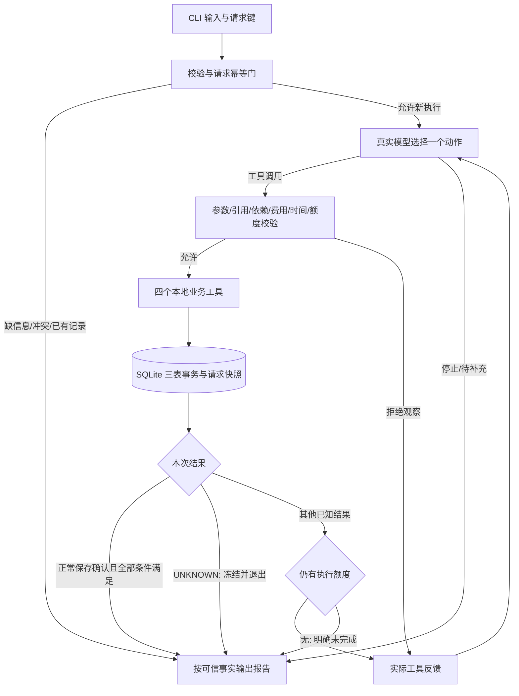

# 内容任务规划 Agent：开发计划与系统设计

调研日期：**2026-11-10（Asia/Shanghai）**。适用题目：小影校招 AI Agent 开发岗位第 2 题。

**最终复核状态（2026-11-11）：本文件保留设计基线；按原题最低要求，现有工程、五类场景及两条真实反馈调整记录支持带局限提交。** 用户已接受C1–C4，编辑附录与原模型输出分开；历史生成盲测不合格及保存场景未触发故障/未通过仍保留，不宣称所有附加条件或生产能力通过。累计真实推理39次、既往测试150项，本轮不新增模型/业务/测试，不改Runtime。完整开发用时未知，三小时为建议。最终证据适用范围、质量缺陷、Git状态和必要提交动作见docs/07-final-delivery.md。原设计示例/拟议实验仍是设计，不冒充执行记录；官方调研保持原文。

## 1. 项目目标、范围、假设与成功标准

### 1.1 业务目标与产物

目标用户是内容运营人员。用户给出活动主题、预算、截止时间、合成素材和工具费用耗时表，系统准备一份可交给负责人审阅的**内容活动方案**。P0 固定提供一份方案和一份脚本正文，至少包含：

1. 活动目标、目标人群、核心信息、内容创意和建议渠道。
2. 实际脚本正文、素材引用及使用限制，不能只返回“生成成功”占位符。
3. 建议的运营任务、依赖、相对节奏、审阅事项、风险和待确认假设。
4. 本次准备工作的任务计划、实际步骤与尝试状态、工具结果、费用明细和合计。
5. 已确认保存的完整方案及回执，或部分方案、明确未完成原因、已有产物与剩余工作。

30 秒、竖屏、分镜时间标注、配文和 CTA 可以作为演示样例和展示素材，**不作为通用成功门槛**。P0 不建设任意类型、数量、时长的通用交付物配置系统。内容是否贴题、可读、可用仍需人工审阅；结构校验不等于营销效果验证，建议指标不能写成已经获得的商业结果。

### 1.2 硬要求、设计假设与 P0/P1

| 类别 | 约束及实现含义 |
| --- | --- |
| 题面硬要求 | 四个业务工具；至少一个真实模型反馈循环；模型根据成本、错误或部分成功选择后续动作；成功结果保留；有界退出。 |
| 题面硬要求 | 正常、缺预算、缺截止、工具失败、超预算、重复执行均覆盖；至少两条合格真实动态路径、至少三组实际输入/输出/运行记录。本设计本身不充当运行证据，实际工程与证据状态见docs/03-evaluation.md。 |
| 设计假设 A1 | 预算为整数模拟单位 unit，覆盖本次准备工作的检索、脚本生成和保存，估价免费。真实拍摄、投放、采购、活动履约及模型 API 账单不在模拟账本内。 |
| 设计假设 A2 | 截止时间约束方案准备并确认保存完成，不是营销活动执行结束；缺活动日期时使用“审批后 T 日”等待确认建议。 |
| 设计假设 A3 | basic/premium 均交付同样的最小产物，只改变创意与模板细化方式。用户明确提出的硬需求必须保留；不支持或无法核验时先说明能力缺口/请求澄清，不得为省钱自动删除。 |
| 设计假设 A4 | 软偏好独立存放，允许模型有依据地让步；预算、截止和已接受的硬需求不可放宽。 |
| 设计假设 A5 | 单 CLI、单 Agent、串行工具、一个真实模型适配器、SQLite 三表；请求内素材与费表版本冻结，账本与时钟实时更新。 |
| 设计假设 A6 | 业务工具为本地函数或 Mock；生成工具采用本地模板加模型选择的创意参数，内部不再调用隐藏的付费模型。 |
| P0 | 三表 JSON 快照、同进程模型选择重试或停止、成功操作复用、已结束请求只读重放；正常保存事务确认后立即结束；UNKNOWN 冻结后退出。 |
| P1 / 加分项 | UNKNOWN 后一次本地回执查证、复杂响应丢失恢复、跨进程失败续跑和并发接管；通用交付物配置、扩展视频规格验证和更多模板。 |

模拟预算可严格核对，不能据此推算 API 费用。模拟耗时和实际模型网络等待分别记录，不能宣传为生产 SLA。三小时只是工时估计，范围冻结条件见第 12 节，不是验收门槛。

### 1.3 成功判定

`task.status=COMPLETED` 必须同时满足：输入完整；方案可审阅且包含实际脚本正文；引用的素材和产物存在且属于本请求；必要依赖与已接受硬需求满足；实际费用正确且不超预算；按第 7.3 节时间口径满足截止；正常保存事务已确认，方案正文与 `SaveReceipt` 一致，`save_state=CONFIRMED`。

模型自主选择调用 `save_plan`；程序完成上述核验后立即生成最终报告并结束，**不再请求模型收尾**。最后一个合法调用确认保存成功，也可以完成；尚未完成且额度耗尽，必须返回明确未完成状态。UNKNOWN 不能被当作成功、免费、明确失败或未提交。

`preparation_status=READY_FOR_REVIEW` 只表示准备好供审阅；`campaign_execution_status=NOT_STARTED` 始终保留。不触发真实发布、投放、支付或消息发送。其他结果为 `NEEDS_INPUT / INCOMPLETE / FAILED`，不能由模型文字覆盖。一次正常演示不等于通过完整验收；真实路径或必要场景证据不足时明确标为未验证/未达标。

## 2. 官方资料调研、技术比较与最终选型

### 2.1 已查阅的官方依据

以下资料均于 **2026-11-10 实际打开查阅**。`F` 是资料支持的事实；后续 `J` 是本项目工程判断。没有核实具体安装版本、账户可用模型、价格、吞吐或延迟，不填写这些数据。

| 编号 | 官方事实与来源 |
| --- | --- |
| F1 | 原生工具调用可以按“提供工具→模型提出调用→应用执行→按调用标识回传结果→模型再次决定”的循环运行。OpenAI 的示例协议支持关闭并行工具调用和严格 schema；这些参数不代表所有厂商通用，schema 合法也不等于业务合法。[OpenAI Function calling](https://developers.openai.com/api/docs/guides/function-calling) |
| F2 | LangGraph 用共享状态、节点和边表达编排，可混合确定性步骤与模型步骤，并不要求使用 LangChain。[LangGraph overview](https://docs.langchain.com/oss/python/langgraph/overview) |
| F3 | LangGraph 官方快速入门展示了模型调用工具后再回到模型的循环；图本身不会自动产生业务决策。[LangGraph quickstart](https://docs.langchain.com/oss/python/langgraph/quickstart) |
| F4 | LangGraph 的 checkpointer 保存线程图状态；store 用于图外跨线程数据。持久化有助于中断后恢复。[LangGraph Persistence](https://docs.langchain.com/oss/python/langgraph/persistence) |
| F5 | LangGraph 节点重试仍需处理副作用幂等；缺少确认应视为结果未知并查证，不能直接认为没有发生。[LangGraph Fault tolerance](https://docs.langchain.com/oss/python/langgraph/fault-tolerance) |
| F6 | ADK 的 `LlmAgent` 由模型根据指令、上下文和工具描述选择工具与后续行为。[ADK Simple agents](https://adk.dev/agents/llm-agents/) |
| F7 | ADK 的 Runner 处理事件和状态提交；Session 具有状态和事件，内存服务与数据库会话服务的持久性不同，可使用数据库会话服务保存到 SQLite。[ADK Event Loop](https://adk.dev/runtime/event-loop/)、[ADK Session](https://adk.dev/sessions/session/) |
| F8 | SQLite 事务提供原子提交语义；本设计据此把本地方案、回执和费用写入同一事务，仍遵守其文件系统和硬件假设。[SQLite Atomic Commit](https://www.sqlite.org/atomiccommit.html) |

链接核对：查阅时旧 ADK `google.github.io/adk-docs` 页面跳转至 `adk.dev`；LangGraph 旧 `durable-execution` 页面跳转至 `persistence`。上表使用本次实际落地页面。开发时应重新确认所用 SDK 的接口和安装版本，记录在依赖锁定文件，不把今天的文档当作永久兼容承诺。

### 2.2 三条路线的简洁比较

| 维度 | Python 原生工具调用循环 | LangGraph | Google ADK |
| --- | --- | --- | --- |
| 本题要实现什么 | 四工具、模型适配、消息与动作循环，以及业务状态、账本、时钟、幂等与输出核对。 | 四工具和同样的领域约束，另定义状态、模型/工具节点、回边和持久化配置。 | 四工具和同样的领域约束，另配置 LlmAgent、Runner、Session 与服务。 |
| 模型动态决策 | 模型选择 function call；应用回传真实结果，下一次调用重新选动作。[F1] | 模型节点选择工具，工具节点返回观察再进入模型节点；仅把超预算接到固定廉价节点仍不够。[F3；后半为 J] | LlmAgent 根据当前上下文选择工具与后续动作，业务观察必须进入事件或上下文。[F6] |
| 状态与失败恢复 | 自行用 SQLite 保存业务结果与运行事件；恢复边界完全由自己定义。[J] | checkpointer 支持图状态恢复；业务收费与保存仍须幂等和对账。[F4、F5] | Session 服务保存会话状态与事件；仍须单独设计费用账本和方案回执。[F7；业务取舍为 J] |
| 依赖与学习成本 | 标准库 + schema 库 + 单一模型 SDK；需亲自写循环和事务。[J] | 需掌握图、状态更新和 checkpointer；模型集成仍有依赖，不能简单认为“零业务代码”。[J] | 需掌握 Agent、Runner、Event、Session；数据库服务需要对应额外依赖和驱动。[J；实际版本待安装确认] |
| 三小时适配性 | 四工具、串行链路、重点在预算/保存核对时最直接。[J] | 已熟悉时可用；首次学习不优先，续跑变为核心需求时价值上升。[J] | 已熟悉 ADK 时可用；本题暂用不到多 Agent 和部署生态。[J] |

以上没有框架速度、模型效果或绝对开发效率排名；三小时判断取决于开发者熟悉程度。

### 2.3 最终选型

**推荐：Python 原生单 Agent + SQLite + CLI。**理由是业务工具只有四个，串行模型循环易于审查；把有限时间用于费用去重、失败真实性、最终方案和真实路径证据，比新增编排抽象更贴近考核目标。SQLite 同时承载方案和本地操作回执，避免文件写入与收费数据库之间的双写问题。

拟用一个支持 function calling 的真实模型适配器；为减少实现分支，可先按官方 OpenAI Responses 协议设计，实际模型 ID 通过配置提供，接入时验证工具调用能力。不承诺任意所谓兼容接口都可用。当前只参考 OpenAI Docs 协议，不选择付费套餐，也不发起模型调用。

不同时实现 LangGraph、ADK 三套后端。若开发者已经熟练掌握其中之一，可以替换编排层，但本文件中的费用、幂等和成功判定仍然有效。

## 3. 核心业务流程与架构

### 3.1 架构图



正常保存的 COMMIT 确认及回执返回属于 P0 保存协议；**UNKNOWN 后再发起自动回执查询属于 P1**，不出现在 P0 循环、工具返回后或退出收尾中。

### 3.2 正常链路与可变部分

1. 校验主题、预算、截止、目录和硬需求支持能力；缺信息为待补充，不猜预算或日期。
2. 模型选择检索词与过滤，调用 `search_materials`。
3. 模型提交初始候选规格给 `estimate_plan`；程序登记不可变快照，返回报价 ID、费用明细、时间和可行性。
4. 模型观察反馈后选择引用该候选、提交替代规格、补查或有依据地停止，不要求先选 premium。
5. 模型调用 `generate_script(quote_id)`；程序读取引用的规格，先检查已成功操作复用，再对新执行重算约束并记账。
6. 模型引用已有报价调用 `estimate_plan` 复估；候选不变，但必须读取最新账本和时钟并返回新报价 ID。生成费用已付时不再计入剩余费用。
7. 模型组织完整方案，调用 `save_plan(quote_id, script_artifact_id, draft)`；确认保存即结束。明确失败且仍有额度时，把反馈交回模型选择复用重试、调整或停止；UNKNOWN 直接保守退出。

固定的是依赖和硬约束，不是业务选择。代码不能把“超预算”直接变成“选择 basic”，不能自动重试业务工具。新规格只在首次规划或明确调整方案时提交；生成、同候选复估和保存不再要求模型重传完整规格。

### 3.3 两类任务计划

本次准备工作的最小里程碑依赖为：

```text
retrieve → estimate(new_spec) → generate(quote_id)
         → estimate(quote_id, post_generation) → save(new_quote_id)
                                                ↓
                                     正常确认：立即报告并结束
```

里程碑是程序约束；模型选择查询、候选和替代路径。候选快照、报价、步骤、尝试和产物存在 `requests.snapshot_json` 中，不分别建表。额外查询、替代报价、新生成追加记录；重试是原逻辑步骤的新尝试。旧成功结果和沉没成本不因候选被替代而丢失。

活动本身另有建议任务 `campaign_tasks`，如审阅→制作→发布→复盘，全部为 `NOT_STARTED`。它们与本次工具步骤的实际状态分开，不宣称活动已执行。

## 4. 输入、输出及领域数据结构

### 4.1 输入契约

| 字段 | 类型与规则 |
| --- | --- |
| `request_key` | 调用方稳定提供的非空字符串；请求级幂等键。 |
| `theme` | 非空文本，限制长度，不接受只有空白。 |
| `budget_units` | `int >= 0` 或 null；拒绝布尔、浮点、负数和 NaN；0 是明确预算，不是缺失。 |
| `deadline_at` | 带 UTC offset 的 RFC3339 时间或 null；内部 UTC，展示 Asia/Shanghai；缺时区或只有日期则请求补充。 |
| `materials_catalog / cost_catalog` | 登记的本地目录 ID，绑定实际内容摘要与版本；不接受模型指定任意路径。 |
| `hard_requirements` | 用户明确硬需求的文本列表，可空；原文随请求冻结。P0 只接受已实现且可核验的有限约束，例如必用素材、必含原文片段；无法判定或超出能力时澄清/说明不支持，不静默忽略。通用类型/数量/时长配置留给 P1。 |
| `preferences` | 可让步的软偏好列表；演示性视频规格放此处，不自动升级为通用硬需求。 |
| `parent_request_key` | 可空；补充信息或显式修订用新键关联原请求。 |

**设计示例，仅用于冻结时钟的确定性用例：**

```json
{
  "request_key": "demo-budget-001",
  "theme": "毕业季：用旧照片做一支回忆短片",
  "budget_units": 10,
  "deadline_at": "2026-11-10T10:20:00+08:00",
  "materials_catalog": "materials-v1",
  "cost_catalog": "cost-v1",
  "hard_requirements": [],
  "preferences": ["预算允许时优先高级叙事", "展示样例可采用约30秒竖屏脚本及分镜时间标注"],
  "parent_request_key": null
}
```

测试起点为 `2026-11-10T10:00:00+08:00`。真实实验运行前生成当时的绝对截止时间，例如开始后 20 分钟，保存解析后的实际输入；不能沿用已过期的日期。用户实际提出的精确视频规格若超出 P0 核验能力，须在执行前说明，不能将它改写成软偏好继续报成功。

### 4.2 领域类型与不可变引用

这些是 JSON 领域对象，不对应同名独立数据表。

| 类型 | 关键字段与约束 |
| --- | --- |
| `TaskSnapshot` | `request_id, input, status, termination_reason, candidate_snapshots, estimates, steps, attempts, artifacts, events, saved_plan, save_receipt, save_state, cumulative_sim_elapsed_s, ledger_revision`。 |
| `CandidateSpec` | 模型首次/调整时提出的 `material_ids[], mode(basic/premium), creative_brief`。程序绑定主题、硬需求摘要、素材内容与费表版本，形成规范化有效规格。 |
| `CandidateSnapshot` | `spec_hash, canonical_spec, bound_material_digests, hard_requirements_hash, created_event_id`；登记后不可变；展示 revision 可记录，但不决定收费身份。 |
| `Estimate` | `quote_id, candidate_spec_hash, stage, ledger_revision, cost_catalog_hash, observed_at, effective_now, incurred_units, remaining_items[], projected_total_units, budget_gap_units, remaining_sim_s, projected_finish_at, deadline_gap_s, feasibility`。报价绑定快照，每次复估是新对象。 |
| `LogicalStep` | `step_id, kind, depends_on[], spec_hash, status, result_ref, replaced_by`；程序根据已确认结果投影状态。 |
| `Attempt` | `attempt_id, step_id, operation_key, attempt_no, provider_call_id, status, timestamps, observation, error_code, sim_elapsed_s, reused_from`。 |
| `Artifact` | `artifact_id, kind, operation_key, effective_spec_hash, material_refs, body_json`；成功后不可变。 |
| `OperationRecord` | `operation_key, request_id, tool, effective_args_hash, status, execution_attempt_count, confirmed_result_json`；支持成功复用，详见第 7.4 节。 |
| `LedgerEntry` | `entry_id, request_id, operation_key, attempt_id, tool, amount_units, catalog_version, committed_at`；整数费用，收费操作键唯一。 |
| `CampaignDraft` | `title, objective, audience, key_message, channels, script_artifact_id, material_refs, campaign_tasks, risks, assumptions`；可附配文、CTA、分镜等展示字段，不以它们作为通用门槛。 |
| `SaveReceipt` | `plan_id, request_id, content_hash, save_operation_key, saved_at_utc, effective_completed_at, ledger_revision_after, total_actual_units`。 |
| `FinalReport` | 完整/部分方案、任务/步骤/尝试/保存状态、工具结果、费用与最新投影、回执或未确认说明、未完成原因和剩余项。 |

`quote_id` 是引用入口：先验证所属请求，再解析到唯一 `candidate_spec_hash` 和不可变快照。它不是候选的收费身份。首次报价可记为 Q1；生成后引用 Q1 复估返回 Q2，Q1/Q2 指向同一规格但账本与时间快照不同。程序不要求用旧报价的金额作为新报价输入。

`campaign_tasks` 包含描述、依赖、建议角色和相对节奏，状态固定 `NOT_STARTED`。费用、可信状态和回执由程序填充，不能采信模型 Draft 中自报的成功或总价。

### 4.3 输出规则

- CLI 拟导出 `output.json` 和 `report.md`。正常保存的数据库事务是保存事实来源，导出是衍生步骤，不再调用模型。
- 展示已发生与剩余预计费用及总计；正常完成时剩余为 0，实际总计来自账本。重复读取区分历史累计和本次增量 0。
- 未完成时保留已有正文与产物，列出剩余事项和可核算缺口；无法确认则明确未知。只有穷举受支持候选空间后才能声称本地最低成本，否则只能报告已评估候选的缺口。
- UNKNOWN 报告展示最后可信费用与待确认操作，不将旧快照当作当前确定总额；无回执不声称保存成功。P0 不为生成报告而自动查证 UNKNOWN。

## 5. 四个工具的接口契约

### 5.1 公共协议

每个模型调用含 `decision_summary`（一到两句动作依据，不要求内部思维过程）和业务参数。请求 ID、操作键、尝试号、可信状态、时钟、账本和故障配置由执行器管理。严格 schema 的可选字段显式允许 null，程序再次校验。

```text
ToolResult {
  request_id, step_id, attempt_id, operation_key,
  outcome: SUCCESS | FAILED | REJECTED | UNKNOWN,
  data: object | null,
  error: {code, message, retryable, details} | null,
  charged_units: int | null, sim_elapsed_s: int | null,
  reused: bool, result_ref: string | null,
  ledger_revision: int | null, observed_at: timestamp
}
```

`charged_units` 和 `sim_elapsed_s` 是本次增量，复用为 0；UNKNOWN 可为空，不可假定为 0。`retryable` 表示条件允许，不触发自动重试；UNKNOWN 一律不可直接重试。所有结果保留原始错误与已确认产物。

公共拒绝码：`INVALID_ARGUMENT`、`INVALID_QUOTE_REF`、`DEPENDENCY_UNSATISFIED`、`HARD_REQUIREMENT_VIOLATION`、`BUDGET_GUARD`、`DEADLINE_GUARD`、`STALE_ESTIMATE`、`ATTEMPT_LIMIT`。拒绝不开始业务执行，费用和模拟时间均为 0。已有未确认操作时直接以 `RESULT_UNKNOWN` 未完成退出，不继续调用工具。

### 5.2 `search_materials`：素材检索

| 项目 | 契约 |
| --- | --- |
| 输入 | `query: string`按空白分词、任一词不区分大小写作子串匹配；`filters: {tags: string[], allowed_usage: string\|null}`：tags全部精确匹配（AND），[]不滤标签；usage精确匹配，只有null不限。`limit: int`，1–5。语义词放query，不假定为目录标签。目录取请求绑定值。 |
| 成功输出 | `result_id, query, catalog_version, matches[], feedback`；素材项含 `material_id, title, facts[], tags[], source_ref, usage_scope, content_digest`。feedback报告实际过滤条件、关键词命中/过滤后（limit前）/返回计数、实际目录可用标签与usage及未识别值；空结果区分无关键词命中/过滤排空。空命中也是成功检索，不能伪造素材。 |
| 错误/重试 | `SEARCH_TEMPORARY` 可由模型选择重试；`CATALOG_NOT_FOUND / CATALOG_INVALID` 原样不可重试。空结果由模型决定改查询、减少可选过滤或停止，后台不自动清空过滤/改OR；硬过滤不得放宽，不支持时保留原文并澄清。无实际命中不能用空material_ids估价。 |
| 费用/耗时 | 成功包括空结果：1 unit / 60 模拟秒；已开始的明确故障：0 unit / 60 秒；守卫拒绝：0/0。每次新执行检查可用预算与截止。 |
| 副作用 | 检索结果、尝试、模拟时间和成功费用写入三表事务；不修改素材目录。 |
| 幂等/复用 | 同请求、同规范化 query/filters/limit、同目录版本，成功后复用原结果，增量 0/0。新查询是新操作，可能收费；失败不缓存成成功。 |

### 5.3 `generate_script`：脚本生成

| 项目 | 契约 |
| --- | --- |
| 输入 | `quote_id: string`。由引用解析不可变规格；不再提交 CandidateSpec、模式或展示 revision。 |
| 成功输出 | `artifact_id, effective_spec_hash, material_refs, mode, script: {title, body}, warnings[]`；可额外附演示性 `display_extras`，例如约30秒/竖屏/分镜标注，不纳入通用成功条件。 |
| 引用与复用 | 验证报价归属和素材引用后，按解析出的有效规格摘要查成功操作。已成功则返回同一产物，新增费用/模拟耗时为0；此时不要求旧报价账本版本仍新鲜，也不因原报价stage不同重新生成。 |
| 新执行前置 | 没有可复用成功结果时，须使用同规格的 `pre_generation` 可行报价；核对账本版本、必要依赖和已接受硬需求，再读最新账本/时钟，检查包括保存在内的完整剩余路径。 |
| 错误/重试 | `GENERATION_TEMPORARY` 可由模型重试；`UNSUPPORTED_SPEC / INVALID_MATERIAL_REF` 原样不可重试；`SCRIPT_INVALID` 需修正规格或停止，不能记成功。 |
| 费用/耗时 | basic 成功6 unit / 240秒；premium 成功10 unit / 480秒。已开始且明确失败0费用、按所选模式全额消耗模拟时间；拒绝0/0。 |
| 副作用 | 脚本、操作结果、费用和时间同事务提交；保存失败不删除已成功脚本。 |
| 幂等 | 键取实际素材内容、模式、创意规格、请求硬需求摘要与工具版本，不取quote_id、call_id或展示revision。同规格换报价仍复用；真正改规格需新估价并保留沉没成本。 |

本地模板必须产出可审阅正文，检查非空、引用和受支持硬需求；不能仅返回占位成功。P0 不证明成片时长，不强制分镜秒数之和；语义质量由人工审阅。

### 5.4 `estimate_plan`：成本与时间估算

| 项目 | 契约 |
| --- | --- |
| 输入 | `new_spec: CandidateSpec\|null`；`quote_id: string\|null`；`stage: pre_generation\|post_generation`；`script_artifact_id: string\|null`。new_spec 与 quote_id 必须且只能填一个。首次/调整提交 new_spec，stage为pre_generation；同候选复估只填quote_id。post_generation须引用报价并提交匹配的成功脚本ID。 |
| 快照登记 | new_spec经参数、引用和硬需求校验后登记不可变规格；相同有效规格可共用spec_hash。quote_id仅定位既有规格，不把原报价金额/时间当作当前结果。 |
| 输出 | 新的 `quote_id` 和完整 Estimate；明细有 `operation_fingerprint, tool, fee_units, duration_s, disposition: ALREADY_PAID\|REUSE\|REMAINING, result_ref`；可行性为 `FEASIBLE\|OVER_BUDGET\|OVER_DEADLINE\|BOTH`。 |
| 计算 | 每次读取最新账本、成功操作、累计模拟时间及真实时钟；补全必需剩余步骤。已付生成费只计在I，不再进入R。存在UNKNOWN时不出确定报价，直接终止本轮执行。 |
| 错误/重试 | `ESTIMATE_READ_TEMPORARY` 在确认无写入副作用时可由模型重试；`INVALID_CANDIDATE / INVALID_QUOTE_REF / CATALOG_INVALID` 原样不可重试。写入报价快照是否成功不明时按UNKNOWN退出，不自动查证。 |
| 费用/耗时 | 0 unit / 0 模拟秒；真实处理时间照实记录；估价不写收费条目。 |
| 副作用 | 新报价、规格快照和尝试写入requests快照；每次估价操作使用独立invocation身份，不命中语义成功缓存。 |
| 复用规则 | 仅可复用静态目录解析与不可变规格，**不可复用旧总价、旧账本或旧时钟**。引用Q1复估可得Q2；Q1/Q2身份不同不改变生成收费键。 |

超预算是估价工具成功返回的业务事实，不是执行异常：该估价步骤可以成功，但候选不可行，生成和保存尚未成功。模型随后选择替代、调整或有依据停止。

### 5.5 `save_plan`：保存完整活动方案

| 项目 | 契约 |
| --- | --- |
| 输入 | `quote_id: string`；`script_artifact_id: string`；`draft: CampaignDraft`。quote_id须为同候选生成后复估的报价。模型不再传CandidateSpec/revision，不能自报费用或成功状态。 |
| 正常成功输出 | `receipt: SaveReceipt, document_ref, reused`；正文、回执和费用在同一已确认事务中，数据一致且可从本地正常保存结果读取。此正常事务确认是P0，不等于UNKNOWN后的自动查证。 |
| 新保存前置 | 校验报价归属、候选和脚本匹配、正文/引用/硬需求及全部必要依赖；将实际脚本正文、素材出处和程序计算的费用展开进完整方案，不能只保存artifact ID或日志；报价基于生成后的账本；事务提交前用最新账本和时钟再核对预算、业务截止和运行额度。 |
| 错误/重试 | `SAVE_TEMPORARY`为明确提交前失败，可由模型重试；`SAVE_PERMISSION_DENIED`原样不可重试；`PLAN_INVALID`须修改正文；`ALREADY_SAVED_CONFLICT`不覆盖已有不同内容；`SAVE_RESULT_UNKNOWN`立即冻结退出，不自动查证或重试。 |
| 费用/耗时 | 首次确认成功1 unit / 60秒；明确提交前失败0 unit / 60秒；参数/守卫拒绝0/0。提交结果不明时费用和时间增量标未知，不按免费失败处理。 |
| 副作用 | 同事务更新requests中的完整方案、唯一回执、状态和累计模拟时间，operations写确认结果，ledger_entries写保存费；请求至多一份最终方案。正常确认即返回终态，不再请求模型收尾。 |
| 幂等/复用 | 保存键绑定规范化正文、有效候选和脚本内容，不绑定quote_id；同内容的已确认保存返回原plan_id，增量0/0。请求级重放先返回既有结果；UNKNOWN请求不盲重跑。 |

传输响应丢失不能倒推事务失败。P0 只报告本次观察未确认并停止；不得用旧内存快照覆盖可能已提交的方案、回执、账本版本或时间。UNKNOWN自动回执查证及复杂故障恢复见第8.3节P1。

## 6. 模型决策循环伪代码及终止机制

### 6.1 模型与程序分工

| 模型选择 | 程序约束 |
| --- | --- |
| 查询、补查、候选素材、basic/premium与创意。 | 参数、目录白名单、素材与报价引用归属、正文结构。 |
| 看超限、工具失败或部分成功后，替代、调整、重试或有依据停止。 | 账本、时间、硬需求、依赖、幂等与执行额度。 |
| 何时调用保存，组织方案及简短依据。 | 正常事务确认、成功条件核对、保存即终结、UNKNOWN冻结退出、最终报告。 |

允许“缺预算→不收费”“已成功→只读复用”“超限→拒绝当前新执行”“额度耗尽且未完成→结束”。禁止“超预算→代码选basic”“失败→自动重试”。UNKNOWN保守停止属于执行一致性约束；其他已知反馈在有额度时交回模型。

### 6.2 模型协议

四个function tools，单轮至多一个调用；采用F1协议时关闭并行调用，严格schema和程序校验并用。所有引用均限制在本请求，不信任素材中的操作指令。

无工具时只接受 `StopDecision {action: stop|need_input, decision_summary, reason_code, missing_fields[], pending_items[]}`。不设置保存后的模型finish阶段；模型自然语言声称完成或非法finish不能改变状态，返回协议错误观察并计入额度。未有保存回执就不能输出成功。

每轮上下文含原需求/硬约束、候选与报价引用、成功产物、最新账本与时钟摘要、实际工具观察、剩余额度。导出动作与简短依据，不索取内部思维过程；必须保留继续工具对话所需的提供方协议对象。适配器出站只保留一份最新完整快照，以对象身份替换明确由自身生成的旧消息；不得按任意文本关键词删除历史。最新快照置输入首位，原生调用、call_id对应观察及提供方续接对象保持完整相对顺序；数据库和完整Trace不因出站缩减而改写。

### 6.3 循环伪代码（设计示例，待实现）

```text
parse input; collect missing fields without guessing values
if malformed: return explicit input error
bind request_key to canonical input hash and frozen data digests
if key_conflict: return conflict; do not change old request
if existing_request:
    return persisted facts or last-known/unknown report, replay=true
    # 不启动新模型/工具，不执行UNKNOWN查证，不接管旧运行
if missing budget/deadline: persist NEEDS_INPUT; return report
if unsupported hard requirements: persist NEEDS_INPUT/FAILED with reason; return report

start run; model_turns = 0; tool_requests = 0
persist RUNNING snapshot
while true:
    if any unresolved operation: return INCOMPLETE(RESULT_UNKNOWN) without new execution
    if remaining model/tool/wall budget is exhausted:
        persist known incomplete state if safe; return INCOMPLETE(actual_limit_reason)

    snapshot = load trusted state and fresh clock
    increment model_turns before sending request  # 失败请求也计数
    response = model.choose(tools, snapshot, actual_observations,
                            timeout=min(configured_timeout, remaining_wall_budget))
    record actual public response or model error
    if model request failed: return INCOMPLETE(MODEL_UNAVAILABLE)

    if response is a valid StopDecision:
        persist NEEDS_INPUT or INCOMPLETE with actual reason; return report
    if response is not exactly one tool call:
        append protocol_error observation; continue
    if no remaining wall/tool budget:
        return INCOMPLETE(actual_limit_reason)  # 不超限补调用

    increment tool_requests  # 接纳后，含参数拒绝、复用与估价
    validate schema, tool name, request ownership and quote references
    if invalid:
        observation = REJECTED(details, charge=0, sim_time=0)
    else if tool == estimate_plan:
        observation = execute_fresh_estimate(new_spec OR quote_id, latest ledger/clock)
    else:
        if tool == search_materials: take canonical query/filters/limit
        else: resolve quote to immutable spec for generate_script/save_plan
        derive tool-specific effective operation key
        if confirmed success already exists:
            observation = reuse original result, new charge/time = 0
        else if dependency/freshness/fee/time/attempt guard rejects:
            observation = REJECTED(actual reasons, 0, 0)
        else:
            observation = execute one local tool with bounded transaction

    if observation == UNKNOWN:
        freeze further execution
        emit INCOMPLETE + applicable UNKNOWN states + last-known facts
        # 不自动查询回执，不用旧快照回写可能已提交的结果
        return report; mark persistence uncertainty if necessary

    if tool == save_plan and observation confirms receipt and all business conditions:
        # 保存事务已写入结果与完成状态；不为追加日志再次改变终态
        return COMPLETED + CONFIRMED, render report without calling model

    record other known observations without erasing prior successes
    if remaining model/tool/wall budget is exhausted:
        persist INCOMPLETE with last observation and actual limit reason; return report
    append function_call_output(call_id, observation) to next model request
```

正常保存已确认后，事件导出或报告文件写入失败只作为报告/导出错误，不能改写COMPLETED和CONFIRMED，也不重做保存。其他已知结果的记录失败若阻断安全继续，则停止并披露持久化限制，不能删除已确认业务事实。

没有退出后的模型调用、自动对账或任意重新投影终态。一次准入合法且正常确认的最后保存调用先进入完成分支；其他结果才检查额度并决定是否还能把反馈交回模型。未进入下一模型请求的反馈不能充作动态路径证据。

### 6.4 计数、终止与最终报告

- 默认最多12次模型请求、10次接纳的工具请求；参数错误、守卫拒绝、估价和复用均消耗对应额度。达到额度且业务未完成就停止，不发送第13次模型或第11次工具请求。
- 同一语义操作最多2次实际执行，包括首次和模型主动选择的一次重试；`execution_attempt_count`只在实际开始时增加。REJECTED/REUSED只占总工具额度。估价每次新invocation，不走语义结果缓存，只受全局边界约束。
- 拟设模型请求20秒、整次运行180秒、工具处理3秒短超时，实际接入时验证并记录配置；它们是单次运行保护，不是三小时开发门槛。关闭SDK隐藏自动重试，最后请求/工具等待受剩余运行时间进一步限制。
- 本地工具不sleep，不接任意无限函数；SQLite锁等待短超时。保存提交前核对运行时间预算与业务截止，未提交的超时应回滚；不能确认提交结果则UNKNOWN退出。
- 不论剩余额度多少，UNKNOWN都立即退出。P0不配置对账次数/对账超时。正常保存确认后的本地报告渲染不追加业务动作；导出失败标明已保存事实，不重做保存。

**最后一次合法保存调用的三个边界：**

| 实际结果 | 任务/保存状态 | 后续行为 |
| --- | --- | --- |
| 正常事务已确认，所有业务条件满足 | `COMPLETED / CONFIRMED` | 立即报告；无模型收尾，无额外工具。 |
| 明确提交前失败 | `INCOMPLETE / FAILED`，终止原因含额度耗尽及原错误 | 保留脚本和费用；无额度时不补重试。 |
| 结果未知 | 本次报告为 `INCOMPLETE / UNKNOWN`，持久化事实可能尚不明 | 冻结，不补调用、不假定免费；不覆盖潜在已提交结果。 |

数据库不可用或事务确认不明时，不承诺终止状态已落库。报告区分“本次调用观察”与“最后可信持久化事实”，注明未能安全持久化终止；不把旧JSON快照整体写回。第8节定义之后重复请求的只读行为。

## 7. 状态、费用账本、时间计算和三表持久化

### 7.1 四层逻辑状态

| 层级 | 枚举与约束 |
| --- | --- |
| 任务 | `CREATED / RUNNING / NEEDS_INPUT / COMPLETED / INCOMPLETE / FAILED`。只有正常确认保存且全部条件满足才能COMPLETED；缺信息待补充；模型停止、额度耗尽或UNKNOWN为未完成。输入非法/基础设施明确故障可FAILED。 |
| 逻辑步骤 | `PENDING / READY / RUNNING / SUCCEEDED / FAILED / UNKNOWN / SUPERSEDED`。依赖满足才READY；成功由已确认结果投影。被替代的未执行节点可SUPERSEDED，旧成功节点仍成功并保留产物。 |
| 尝试 | `STARTED / SUCCEEDED / FAILED / REJECTED / UNKNOWN / REUSED`。失败尝试保留，后一次成功不改写前一次失败；成功操作复用新增一条REUSED观察，不重新执行。 |
| 保存 | `NOT_ATTEMPTED / FAILED / UNKNOWN / CONFIRMED`。正常事务确认才进入CONFIRMED；P0不自动将UNKNOWN转成成功或失败，自动查证是P1。 |

这些对象保存在JSON快照中，不分别建表。操作表只记录操作身份、执行次数与已确认结果，不能让模型直接设置成功。估价步骤成功不等于候选可行；保存步骤失败不抹掉已有脚本。

### 7.2 费用恒等式与账本

整数模拟单位，对请求r、候选c、时刻t：

```text
I(r,t) = 本请求已确认提交的 ledger_entries.amount_units 之和
R(r,c,t) = 必需剩余步骤中尚未成功且不可复用的操作报价之和
P(r,c,t) = I(r,t) + R(r,c,t)
budget_gap = max(0, P - budget_units)
actual_budget_left = budget_units - I
projected_budget_left = budget_units - P
```

I包含本请求所有成功收费操作，包括最终未采用的旧检索/脚本。报价不扣费，不写收费条目；明确失败费用0，记录在尝试中；UNKNOWN费用未确认，不能套“失败免费”。明细中的ALREADY_PAID/REUSE用于解释，不再叠加到R。

所有新收费操作至少检查 `I + 本次最高收费 <= budget`；生成和保存还检查完整必需剩余路径。预算0不能先花1检索。估价每次读最新账本和时钟，执行前复用同一计算函数再守卫，程序只拒绝当前违规执行，不替模型改选。

**设计示例，12→8仅用于说明账本，不要求模型重现：**

| 时点 | I | R | P | 解释 |
| --- | ---: | ---: | ---: | --- |
| 一次检索后报价premium | 1 | 10+1 | 12 | 预算10缺2，但生成10尚未扣费。 |
| 用相同检索结果报价basic | 1 | 6+1 | 8 | 换候选，不改历史账本。 |
| basic生成后引用报价复估 | 7 | 1 | 8 | 已付生成6不再进入R。 |
| 保存提交前明确失败后复估 | 7 | 1 | 8 | 费用不变，已消耗时间增加。 |
| 正常保存确认 | 8 | 0 | 8 | 实际合计1+6+1。 |
| 同请求重放 | 历史8 | 0 | 8 | 本次增量0，不能把历史总计写成0。 |

**沉没成本反例：**独立预算20的请求，检索+premium生成已花11；再明确提出basic新规格，需要新生成6和保存1，预计/最终成功总额为 **18**，不能重置为8。旧premium产物保留并注明未用于最终方案。预算10时不得执行总价12的高级路径。

**同规格换报价：**Q1生成成功后，引用Q1重新报价得到Q2。生成操作键仍按规格摘要；再调用generate_script(Q2)返回原artifact，增量0。报价变化不能改变收费身份。

新执行使用报价时，规格/费表/素材或账本版本不匹配才返回STALE_ESTIMATE；正常时钟前进不要求quote.observed_at等于当前时刻，而是重新计算时间并按需返回DEADLINE_GUARD。quote_id用于复估时只定位规格，旧账本版本不会阻止读取该规格后生成新报价。

UNKNOWN出现后停止计算确定的总价/剩余预算，不继续收费。报告给出 `last_known_confirmed_units`、待确认操作及其最高可能费用；例如最后可信为7、保存最多1，只能说明有待确认的保存费，当前实际总额不能直接写7或8。没有安全确认就保留未知，不伪造收费或退款。

### 7.3 时间计算与最新时钟

统一秒、UTC存储，Asia/Shanghai展示；工具不实际sleep。

```text
effective_now = real_clock.now_utc() + cumulative_sim_elapsed_s
remaining_sim_s = 必需剩余且不可复用的操作模拟秒数之和
projected_finish_at = effective_now + remaining_sim_s
deadline_gap_s = max(0, projected_finish_at - deadline_at)
```

真实网络等待已使real_clock前进，不再把model_latency_ms加一遍。每次已开始的已知尝试仅增加一次模拟时间，包括明确失败；拒绝、估价与成功复用增量0。事务确认不明时报告该增量未知，P0不为补齐时间再查证或重执行。

串行剩余时间求和；估价不预知未来网络耗时，执行前与保存提交前再次读时钟。最终effective_completed_at包含保存60秒。正常确认保存后不再有模型网络收尾；之后导出时间不追溯否定已按时保存的事实。

**设计示例，待确定性验证：**

- basic完整路径模拟耗时 `60+240+60=360秒`；冻结真实时钟起点10:00时预计10:06。premium为600秒、10:10。
- basic生成成功后累计模拟300秒，剩余保存60秒；注入真实时钟前进60秒，新复估应为起点后 `60+300+60=420秒`，即10:07。最终保存确认时间亦应按该口径计算。成功复用生成不重复增加240秒。
- 另一个独立场景：真实时钟冻结，保存先明确失败60秒再成功60秒，basic总模拟时间420秒、费用仍8。它与上一例的“真实推进60秒”是两种独立测试，不能混算为一次360秒路径。

记录 `wall_elapsed_ms, model_latency_ms, cumulative_sim_elapsed_s, time_basis=wall_plus_simulated_tools`。该口径验证模拟准备约束和已发生网络等待，不证明真实拍摄工期或生产SLA。系统UTC时钟异常倒退则CLOCK_ERROR停止；运行上限用单调时钟。已完成请求只读重放不重算原截止，不重复累计模拟时间。

### 7.4 SQLite三表与事务

| 表 | 键与最小内容 |
| --- | --- |
| `requests` | `request_id PK, request_key UNIQUE, input_hash, snapshot_json`。快照包括原输入、目录摘要、任务状态、不可变候选、全部报价、步骤、尝试、产物、公开事件、模拟时间、账本revision、完整方案与保存回执。 |
| `operations` | `operation_key PK, request_id FK, tool, effective_args_hash, status, execution_attempt_count, confirmed_result_json`。约束语义身份、实际尝试上限和成功结果复用；估价每次用独立invocation键。 |
| `ledger_entries` | `entry_id PK, request_id FK, operation_key UNIQUE FK, attempt_id, tool, amount_units, catalog_version, committed_at`。只存已确认收费，不用来替代失败记录。 |

步骤、尝试、候选、产物、报价、事件和回执仍保持逻辑类型，但不建设对应的独立表。单CLI/单写者使用参数化SQL、外键和显式短事务；模型网络请求期间不持有写锁。

事务顺序：

1. 新操作校验后，以短事务登记STARTED与实际尝试次数；已有成功先复用，明确失败可受限重试，未确认/旧活动运行不接管。
2. 成功结果在一个事务内更新最新requests快照、operations结果及ledger_entries费用，模拟时间也只加一次；费用账本无条目不等于操作成功。ledger_revision仅在已确认收费条目提交时递增；免费估价、明确失败或复用不增加该revision，时间变化仍由最新时钟和累计模拟时间反映。
3. 明确失败在短事务记录失败尝试及一次模拟时间，不写收费条目；拒绝和复用仅追加观察，增量0。若这些提交结果本身不明，则按UNKNOWN退出。
4. 保存事务校验后写完整方案、plan_id、唯一回执、保存费、保存操作及步骤成功、任务完成和模拟时间。只有正常COMMIT确认及有效回执返回后，调用方才报告COMPLETED。原子性防止已确认状态中出现半份方案或单独保存扣费。

所有JSON快照更新基于事务内最新数据，不能以过期内存整包覆盖。尤其保存可能已提交但响应丢失时，P0 UNKNOWN分支**不再用旧快照回写INCOMPLETE/UNKNOWN**，以免抹掉新方案、回执、账本revision和完成事实。可安全记录的仅是本次观察；不能安全落盘时输出报告并标明终止观察未持久化。

`final_content_hash`取规范化Draft、有效规格和产物内容摘要，排除quote_id、call_id、展示revision、随机plan_id与导出路径。请求快照至多有一份最终方案；正常导出从已确认数据生成，导出失败为EXPORT_FAILED并附原plan_id，不重做保存。

## 8. 幂等、部分成功、UNKNOWN与恢复

### 8.1 请求级幂等

1. 规范化对象键、UTC截止、整数预算、集合字段与约定空白/Unicode；保留主题和硬需求语义，绑定素材与费表实际内容摘要，不只哈希文件名。
2. 同键同hash：只读返回已持久化事实或最后可信报告，`replayed=true`；不调用模型、不执行收费工具。已正常确认的方案返回原plan_id与历史费用，本次增量0。
3. 同键不同hash：REQUEST_KEY_CONFLICT，不改旧任务、不收费。补预算/期限或修订需求用新键关联parent_request_key。
4. 已记录UNKNOWN或操作STARTED未确认：重复请求只读展示不确定性，不触发查证、续跑或重新收费。若数据库暂不可读，也不启动新执行。
5. 普通重放读取到此前实际已提交的完整方案及正常确认事实，可原样展示；这不授权对UNKNOWN启动额外查证流程。运行中观测UNKNOWN与持久化事实可能不同，报告注明来源，不能用旧报告覆盖真实数据。
6. 同键仍活动或崩溃留下的未终结运行返回IN_PROGRESS/需人工核对，不并发重跑、不自动接管。不同请求键是新业务请求，不做跨请求语义去重。

### 8.2 工具操作身份与部分成功

服务端先校验schema和引用归属，再计算：

`operation_key = hash(request_id, tool, contract_version, effective_semantic_args, bound_data_versions)`。

| 工具 | 有效语义内容 | 不进入收费身份的字段 |
| --- | --- | --- |
| 检索 | 规范化query、filters、limit、素材目录摘要。 | decision_summary、call_id、尝试号。 |
| 生成 | 报价引用解析出的实际素材内容、模式、creative_brief、主题/硬需求摘要及工具版本。 | quote_id、展示revision、模型call_id、容器ID、decision_summary、attempt_no。 |
| 保存 | 规范化Draft、有效候选、脚本内容摘要；引用ID另核验归属与内容。 | quote_id、展示revision、模型call_id、随机plan_id、导出路径。 |
| 估价 | 每次新invocation身份，规格引用仅作输入。 | 不按语义键复用旧报价总价和时钟。 |

报价ID不是计费键。相同有效规格重新登记/报价仍对应同一个生成操作；Q1生成成功后用Q2再次请求生成，必须先复用原成功产物。只有新执行才检查报价新鲜度、依赖、预算与截止；不因时间过去追溯否定只读复用。

`attempt_no`是观察序号；`execution_attempt_count`只算实际开始的执行。明确失败后可由模型带原引用请求下一次尝试；成功复用与拒绝不占实际尝试名额，但计入总工具请求数。UNKNOWN不能开始下一次尝试。

保存失败保留脚本、素材结果、报价和费用。仅改保存文案/活动节奏，不影响生成规格即可复用脚本；改变真实创意、素材或模式需新规格及估价，旧费用仍在I。不能把必需脚本改成只有标题，也不能删掉用户已明确的硬需求来降本。

### 8.3 UNKNOWN：P0停止，P1查证

```text
P0收到UNKNOWN
  → 保留最后可信产物和费用，标记本次未确认观察
  → 冻结后续收费及其他工具执行
  → 返回INCOMPLETE、相关步骤/保存UNKNOWN、明确剩余事项
  → 不补模型调用，不自动查询回执，不从旧快照覆盖可能已提交数据
同键再执行
  → 仅正常读取已有持久化记录/不确定性，不盲目重跑
```

UNKNOWN不等于免费、明确失败或未提交。正常保存时事务确认并返回回执是P0必需能力；UNKNOWN后再按operation_key发起回执查证是**P1增强**。这两个阶段不能混用。

P1拟先增加一次本地只读回执查证：查到匹配方案/回执才确认；查不到不能直接断言未发生，须能证明事务结束且未提交，才允许交回模型决定重试；仍不明就继续停止。次数、超时和复杂响应丢失夹具在实现该增强时另行验证，P0配置不预留自动查证执行路径。外部保存服务或任意崩溃恢复不在当前范围。

### 8.4 已知故障与恢复边界

| 情况 | P0行为 |
| --- | --- |
| 缺预算/期限 | NEEDS_INPUT，列出缺项，不猜值、不收费；补充后新请求关联原任务。 |
| 检索空结果 | 保留真实空结果与检索费；有额度时模型换查询/调整/停止，不编造素材。 |
| 明确生成失败 | 失败尝试和消耗时间保留，不记成功；有额度时模型重试、改方案或停止。 |
| 超预算/超期限 | 保留估价成功但不可行的事实；阻止违规新执行，由模型选择替代/调整/停止。 |
| 明确保存失败 | 保留脚本和账本；有额度时模型选择复用重试或停止，额度尽则直接未完成。 |
| 保存UNKNOWN | 冻结并退出；不宣称成功或免费，不盲重试。 |
| 模型不可用/协议错误 | 已成功结果保留；明确失败或受限纠错后退出，不能以Mock补真实证据。 |
| 进程中断 | 只读已有提交；活动归属、接管及失败点续跑为P1，不因用了SQLite就宣称已实现。 |

## 9. 合成资料、费用表和故障夹具示例

本节均为**设计示例**，不是实际产品声明、商业报价或已发生的运行结果。

### 9.1 合成素材 materials-v1

| ID | 合成内容 | 标签/限制 |
| --- | --- | --- |
| mat-001 | 虚构演示工具“影记”可导入本地照片、添加文字。 | 毕业季、照片；不得作为小影真实产品功能声明。 |
| mat-002 | 合成校园空镜清单：教学楼、操场、毕业合照占位图，无真实个人数据。 | 校园、回忆；demo_only。 |
| mat-003 | 创意建议：开场今昔对照，结尾引导选择一张旧照片。 | 互动、创意；不是已验证增长结论。 |

每项有 `synthetic://materials-v1/<id>` 来源、内容摘要和使用范围。P0用本地标签/文本检索，不引入向量库。模型可写创意，产品事实必须来自引用，不能编造效果、评价或授权。

### 9.2 统一费用耗时表 cost-v1

| 工具/模式 | 成功unit | 成功模拟秒 | 明确失败unit | 已开始的明确失败模拟秒 |
| --- | ---: | ---: | ---: | ---: |
| search_materials | 1 | 60 | 0 | 60 |
| estimate_plan | 0 | 0 | 0 | 0 |
| generate_script.basic | 6 | 240 | 0 | 240 |
| generate_script.premium | 10 | 480 | 0 | 480 |
| save_plan | 1 | 60 | 0 | 60 |

记录SIM_UNIT及费表版本/摘要。拒绝、成功复用为0增量；估价不收费；UNKNOWN不套明确失败规则。展示性30秒/竖屏字段不改变这张P0报价表，不能使模型自行创造费率。

### 9.3 夹具与优先级

夹具由测试配置注入，模型不能修改；按工具、实际尝试序号和阶段触发，不预写模型下一步。拒绝/复用不消耗实际尝试序号，夹具摘要进入证据。

| 夹具 | 级别 | 作用 |
| --- | --- | --- |
| no_fault | P0 | 正常结果。 |
| save_fail_once | P0 | 首次实际保存明确提交前SAVE_TEMPORARY；模型若选择下一次实际保存则可成功，不强制重试。 |
| known_tool_error | P0 | 参数化检索/生成/保存的明确故障，按费表记录失败时间；可用于第二类动态路径，实际采用一个代表场景即可。 |
| unknown_result | P0测试替身 | 返回UNKNOWN，验证立即停止、费用不冒充已知、不追加调用、不盲重跑；不声称证明真实磁盘响应丢失已恢复。 |
| near_limit_save | P0离线设置 | 先通过工具构造一次检索+basic成功（I=7）的基态，将保存放在最后一个允许工具/模型轮次，分别返回正常确认、明确失败、UNKNOWN。 |
| save_commit_ack_lost | P1 | 真正提交后响应丢失及一次回执查证的集成验证，P0不执行恢复。 |
| save_unknown_unreadable | P1 | 数据库不可读与查证仍不明的复杂故障验证。 |
| search_empty / generate_fail_once | P1扩展场景 | 补充同类反馈的不同来源；不要求为凑两条路径都跑真实实验。空结果与明确失败的基础规则仍由P0契约约束。 |
| cost-premium-low | P1展示对照 | 独立费表把premium生成费改6、其余不变，检索后总价8。只做可选报价对照，不作为取得12→8的前置条件。 |

P0预算实验可使用默认费表与不同请求预算/软偏好，例如预算3评估任何受支持候选均不可行；也可观察预算10的候选超限后替代。模型若未经过真实工具超限反馈就直接停止或选便宜方案，记录为实际行为，但不计入第一类动态证据。不同输入或费表必须用不同请求键，单请求内不热改费用。

## 10. 验收矩阵与真实模型实验计划

### 10.1 三层验证与证据

| 层级 | 验证内容与边界 | 当前状态 |
| --- | --- | --- |
| L1确定性工具/状态测试 | 注入时钟、合成数据和临时SQLite，检查引用、费用、时间、三表事务、幂等和状态。不能证明模型决策。 | 已实施；实际结果见docs/03-evaluation.md。 |
| L2离线模型流程 | 显式offline_mock动作走同一执行器，检查观察回传、部分成功、终结与上限。不能补足真实动态证据。 | 已实施；实际结果见docs/03-evaluation.md。 |
| L3真实模型端到端 | 真模型选择动作，本地业务工具可Mock；核对实际观察进入下一次请求，并驱动后续动作。还需人工审阅内容和决策。 | 未运行：尚缺用户明确模型配置与调用额度。 |

拟用 `examples/runs/<mode>/<run_id>/` 保存：

- `input.json`：实际规范化输入与绝对截止时间。
- `metadata.json`：case/group、request_key、mode、实际模型和依赖版本、提供方请求ID（若有）、代码commit（若有）、prompt/数据/费表/故障摘要、运行时间与上限配置。
- `trace.jsonl`：执行器生成的模型公开动作、参数、简短依据、实际发送的观察ID、工具结果、报价→规格引用、操作键、尝试、费用/时间增量与终止原因。
- `output.json / report.md / ledger.json / artifacts.json / receipt.json`：实际结果；无已确认回执时标缺失或未知，不虚构ID。
- `assertions.json`：运行后计算的断言与实际值、通过/失败/未验证及证据引用。L1/L2报告另入 `examples/test-results/`，不冒充real记录。

数据库中公开事件位于requests快照，无独立events表；导出不得泄露密钥、授权头或内部思维过程。当前实际记录已由程序产生在examples下，索引见docs/03-evaluation.md。每个预期与实际结果分列，失败尝试也保留。

### 10.2 P0验收矩阵（设计要求；实测状态见docs/03-evaluation.md）

`R(Cxx)`指上文真实入口/模型运行目录；`T(Cxx)`指L1/L2测试报告。分组按必要性质组织，可参数化，不要求每个case都在三层机械重复。

| 场景 | 输入/故障 | 预期行为 | 自动断言 | 证据文件 | 层级与人工检查 |
| --- | --- | --- | --- | --- | --- |
| C01正常完成 | 完整输入、预算10、充足期限、no_fault | 交付正文、引用和完整活动方案，模型自主保存后立即结束。 | 正文/引用有效；三表中方案、回执与费用一致；总价不超预算；正常确认后无后续模型调用。一次检索+basic路径实际8，不要求所有路径恰好8。 | R(C01)全套、T(C01) | P0 L1/L2/L3；人工检查方案是否可审阅。 |
| C02缺预算 | budget=null | NEEDS_INPUT，明确补预算。 | 无业务工具执行/收费/回执，不猜值；模型请求0。 | 实际入口input/output/trace、T(C02) | P0 L1；入口记录不假装模型路径。 |
| C03缺期限 | deadline=null | NEEDS_INPUT，明确补期限。 | 不填默认日期、不收费、不声称时间可行；模型请求0。 | 实际入口记录、T(C03) | P0 L1；与C02可参数化。 |
| C04超预算反馈 | 默认费表、预算3或产生真实超限的其他输入 | 真实超限观察进入下一轮，模型替代/调整/有依据停止；不强制12→8。 | 不增加预算/删硬需求/执行违规收费；后续请求确含超限观察；状态费用正确。缺口据最新I+R，不虚称全局最优。 | R(C04)观察→请求→动作、ledger/output，T(C04) | P0 L1/L2/L3；人工判定动作回应反馈且停止有依据。直接廉价选择/无工具反馈停止不算动态证据。 |
| C05工具失败/部分成功 | save_fail_once；明确永久失败可参数化 | 已成功脚本保留；有额度时由模型复用重试、调整或有依据停止。 | 失败尝试不标成功；脚本ID与费用保留；保存费至多一次；不重付生成费；停止时无伪造回执。 | R(C05)全套、T(C05) | P0 L1/L2/L3；人工核对模型确实处理错误/部分成功。 |
| C06请求重放与冲突 | C01同键同输入；同键异预算/资料摘要 | 前者只读原结果，后者冲突；不发起新执行。 | 原plan_id与artifact不变、增量费用0；不同输入不改旧快照；模型/业务调用0。 | R(C06)前后统计和输出、T(C06) | P0 L1/L2；真实组内入口重放，无需新模型调用。 |
| C07最新报价与同规格复用 | 一次检索+basic已成功（I=7）；Q1引用复估得Q2，再用Q2生成、复估 | 每次报价读新账本/时钟；同规格复用原脚本。 | Q1/Q2 ID不同且spec_hash相同；I=7、R=1、P=8；报价不收费；再次生成新费/新模拟秒0；artifact相同。 | T(C07)，R(C01/C05)对应记录 | P0 L1/L2；L3记录交叉核对。 |
| C08沉没成本 | 独立预算20请求，已检索+premium成功花11，再提出basic | 新报价18，成功生成并保存后总额18；旧产物保留。 | 11+6+1=18，不能重置8；旧脚本和收费仍在，最终basic引用正确。 | T(C08) | P0 L1/L2；不需另花真实调用证明确定性算术。 |
| C09时间/截止 | basic路径累计300秒（检索60+生成240）、保存剩60秒，真实时钟注入前进60秒；另测期限不足 | 报价预计起点后420秒；复用不加模拟时间；新执行受最新截止守卫。 | 360+60=420；复用增量0；时钟推进后报价更新；过期执行被拒绝、不延后截止。 | T(C09)，真实记录中的时间字段 | P0 L1；必要L2；人工明确模拟能力边界。 |
| C10最后合法调用及额度 | 一次检索+basic已成功（I=7）；near_limit_save分别正常确认/明确失败/UNKNOWN；另测持续非法动作 | 三分支分别完成、未完成失败、未完成未知；没有补调用。 | 成功COMPLETED+CONFIRMED；失败INCOMPLETE+FAILED保留已花7；未知INCOMPLETE+UNKNOWN、总额不假零；无后续模型/工具；计数不超配置。 | T(C10)按三分支输出与调用计数 | P0 L1/L2；反馈因上限未入下一轮不算动态证据。 |
| C11真实性/UNKNOWN重放 | 未保存却声称完成；unknown_result后同键再执行 | 不凭文字报成功；UNKNOWN冻结，重复只读，不盲跑。 | 无有效回执不COMPLETED；不将UNKNOWN写FAILED/免费/未提交；无自动查证和新收费；不以旧JSON覆盖潜在提交。 | T(C11) | P0 L1/L2；实际数据库响应丢失恢复不在本用例宣称范围。 |
| C12输入/引用/硬需求 | 预算0/非法值、过去期限、越权报价/素材、空脚本、已接受硬需求缺失或能力不支持 | 明确拒绝/待澄清；不漏需求、不保存不完整方案。 | 预算0不能先收费检索；引用须同请求；必需正文/素材引用存在；不支持明确披露；30秒/竖屏展示字段缺失不触发通用拒绝。 | T(C12) | P0 L1参数化；人工确认硬需求与软偏好分离。 |

最小自动性质可合并为七组：输入与引用；账本/最新估价/沉没成本；预算与截止守卫；请求/操作幂等；部分成功与保存事务；UNKNOWN停止；额度与保存即终结。合并不删除上表断言。

### 10.3 P1验证与至少三组实际材料

P1待实现后再验证：一次回执查证、提交后响应丢失/不可读恢复、跨进程失败续跑、通用交付物与视频规格检查、更多模板/报价对照。它们不能挤掉P0证据；P0仍必须验证UNKNOWN保守停止。

后续实际材料建议四组，满足“至少三组”并逐项覆盖：

| 组 | 用例与实际材料 |
| --- | --- |
| G1正常与重复 | C01+C06：真实模型正常完成；同键重放/冲突的实际入口记录及数据库前后费用统计。 |
| G2信息不足 | C02+C03：分别缺预算/期限的实际输入、输出与记录；模型调用为0是正确前置校验。 |
| G3预算动态 | C04：至少一条真实超限工具观察进入下一次模型请求并驱动后续动作的记录。 |
| G4失败动态 | C05或其他真实工具失败/部分成功反馈：至少一条有依据调整或停止的记录；成功结果保留。 |

没有这些实际材料不能标为已验收；离线动作只能作为L2。两类动态路径分别来自G3/G4，正常路径和缺信息入口不能替代它们。

### 10.4 两类真实动态路径与实验停止条件

**第一类：超预算反馈后选择。**模型自由提交任一候选；真实estimate返回超限，再把该观察放入下一次模型请求。合格动作可为替代、调整或有依据停止。12→8仅是参考实例，不能强迫先选premium；直接选便宜方案、或凭已知费表直接停止，业务上可以合理，但没有真实超限反馈就不计入这一类证据。

最小实验可用充足期限、默认费表、低于受支持路径报价的预算，例如3；若模型实际选择估价，所得反馈可用于第一类验证。不能预写它会估价、替代或停止。未触达反馈就如实标证据未取得，不用代码强制初选贵方案。

**第二类：工具失败或部分成功后选择。**最小实验用save_fail_once：脚本已成功，首次保存明确失败。下一轮让模型实际看到脚本ID、已发生费用、错误和剩余时间，选择复用重试、调整或有依据停止；也可采用真实检索/生成故障后改查询等路径。无需把某个工具顺序或必定重试写成唯一答案。

共同合格标准：真实反馈进入下一次真实模型请求，并驱动后续动作；状态与费用正确；已成功结果保留。无依据停止、执行器固定替代/自动重试、预写日志或离线Mock均不能补证据。保存正常确认后直接结束，无需再用模型总结证明完成。

执行器记录每轮真正发送的observed_event_ids、提供方请求/call_id（若有）、工具尝试、报价与规格映射；人工核对反馈与后续动作关联。不能由模型自报“看到了反馈”替代实际上下文记录，也不索取内部思维过程。

后续允许真实调用时，先声明运行次数、调用资源和费用预算；可沿用原设计“最多6次完整真实运行”作为拟议实验资源上限，不是通过门槛，也不保证足以取得证据。模型费用与模拟unit分开；价格未核实则只记录真实usage与费用未知。所有尝试保留，资源不足或到上限仍缺任一类合格路径/必要场景证据，就明确未达标，不无限补跑、不改写记录。

### 10.5 自动断言、人工审阅、待实验问题

自动检查金额、账本唯一键、快照引用、依赖、字段与硬需求的有限核验、时间守卫、计数和终态。人工审阅内容是否可审阅、引用是否支持表述、软偏好取舍是否合理、动作是否回应反馈。结构通过不代表营销效果通过。

仍待真实实验：所配模型是否支持所用协议、能否在工具反馈后合理决策、实际网络等待是否适合超时配置、两类路径能否在资源范围内取得。仍待L1/L2：三表事务和所有不变量，包括新报价不重付、18沉没成本、420秒口径、三个最后调用边界。相关L1/L2已实际运行，结果见docs/03-evaluation.md；真实实验未运行，不能将确定性或离线通过冒充真实模型验证。

## 11. 项目目录、依赖、配置与拟议运行命令

### 11.1 拟议交付结构

下面保留原设计结构；当前实际实现与局部路径差异见README.md和docs/02-solution.md，实际证据见docs/03-evaluation.md。未实现P1不作为现有能力。

```text
content-planner-agent/
  plan.md
  README.md
  pyproject.toml
  requirements.lock                 # 实际安装后锁定，不预填版本
  .env.example
  .gitignore
  src/content_planner/
    __init__.py
    cli.py                          # run / inspect / export
    schemas.py                      # 输入、报价引用、四工具、停止与报告
    agent.py                        # 反馈循环、额度、保存确认即终结
    model.py                        # 单一真实适配器与显式离线Mock
    tools.py                        # 四业务工具；无隐藏模型调用
    store.py                        # requests / operations / ledger_entries
    accounting.py                   # 费用/时间共用计算与守卫
    reporting.py                    # 已知事实与UNKNOWN报告、证据导出
  tests/
    test_contracts.py
    test_accounting_and_time.py
    test_idempotency_and_save.py
    test_agent_offline.py
  data/
    materials-v1.json
    costs/cost-v1.json
    fixtures.json                   # P0夹具
    optional_p1/                    # 增强实现时才加入恢复/报价对照数据
  examples/
    cases/                          # normal / missing_budget / missing_deadline
                                    # budget_feedback / tool_failure 等输入模板
    runs/offline_mock/              # 执行后生成
    runs/real/                      # 真实执行后生成
    test-results/                   # 测试后生成
  docs/
    01-requirements.md
    02-solution.md
    03-evaluation.md
    04-ai-usage.md
    05-retrospective.md
  var/                              # 本地SQLite，默认不提交
```

五文档分别写需求与硬约束、实际方案、预期/实际/未验证的证据索引、AI辅助与实际人工贡献披露、实际问题与投入复盘。未执行的个人验证/修改不能虚构；未尝试内容写未来计划。README说明安装、配置、模拟预算/时间、运行、限制和复现。

### 11.2 依赖和配置

选本机可安装依赖的Python 3，实际小版本待验证；拟运行依赖pydantic和单一提供方SDK（初版可为openai），测试pytest。CLI用argparse、持久化sqlite3、时间datetime/time、摘要hashlib，不新增Web/ORM/队列/向量库/其他Agent框架。

安装后再记录真实依赖版本与锁定结果；当前已实际安装，实际版本和锁定结果见docs/03-evaluation.md。`.env.example`是配置清单；若不用dotenv，README说明由终端设置环境变量，不能宣称文件会自动读取。

```dotenv
# 设计配置清单；实际环境变量与CLI见.env.example和README，不含真实密钥
MODEL_PROVIDER=openai
MODEL_NAME=replace_with_verified_tool_calling_model_id
OPENAI_API_KEY=
PLANNER_DB=var/planner.sqlite3
MAX_MODEL_TURNS=12
MAX_TOOL_REQUESTS=10
MAX_OPERATION_ATTEMPTS=2
MODEL_TIMEOUT_S=20
TOOL_TIMEOUT_S=3
RUN_TIMEOUT_S=180
```

P0没有自动查证配置。真实入口缺密钥明确报错，不悄悄降级Mock；离线入口不要求密钥。目录通过请求ID绑定，测试故障显式注入且默认关闭。模型ID、工具协议、超时适配性和实际价格都待后续验证，不预填“已测版本/价格/性能”。

### 11.3 原设计拟议命令（当前使用README中的已验证命令）

本小节是原设计命令，不作为当前可运行承诺。当前输入由make-input生成到var，examples只含实际产物，未创建这里的examples/cases模板。PowerShell工作目录为content-planner-agent；已验证命令见README，在线入口仍待配置和额度。

```powershell
# 后续环境准备，当前不执行
python -m venv .venv
.\.venv\Scripts\python.exe -m pip install -e '.[dev]'

# 确定性/离线验证，后续实现后才可运行
.\.venv\Scripts\python.exe -m pytest tests -q --junitxml=examples/test-results/junit.xml
.\.venv\Scripts\python.exe -m content_planner.cli run --mode offline_mock --input examples/cases/normal.json --fixture no_fault

# 普通只读查看/导出，不触发UNKNOWN自动查证或续跑
.\.venv\Scripts\python.exe -m content_planner.cli inspect --request-key demo-budget-001
.\.venv\Scripts\python.exe -m content_planner.cli export --plan-id '<confirmed-plan-id>' --out examples/exports

# 后续获准真实调用并配置凭据后，才执行C04/C05实验
.\.venv\Scripts\python.exe -m content_planner.cli run --mode real --input examples/cases/budget_feedback.json --fixture no_fault
.\.venv\Scripts\python.exe -m content_planner.cli run --mode real --input examples/cases/tool_failure.json --fixture save_fail_once

# C01/C06：先正常执行，再以完全相同输入原样重放
.\.venv\Scripts\python.exe -m content_planner.cli run --mode real --input examples/cases/normal.json --fixture no_fault
.\.venv\Scripts\python.exe -m content_planner.cli run --mode real --input examples/cases/normal.json --fixture no_fault
```

缺预算与期限分别用missing_budget.json/missing_deadline.json产生实际入口记录，模型调用为0。没有resume或reconcile命令；这些只在P1实现后再设计。拟议退出码：0可信完成/完成重放，2待补充，3未完成（含UNKNOWN），4参数/键冲突，5明确基础设施失败。导出失败给明确错误及已确认plan_id，不声称保存失败。

## 12. 三小时开发顺序、范围冻结、风险与完成标准

### 12.1 工时估计与开发顺序

三小时是建议工时估计，**不是验收门槛**。下表是粗略投入分配，不按固定分钟数设完成或冻结门槛。实际顺序由阻断与证据余量调整，不能把时间用完等同验收完成。

| 阶段 | 粗估投入 | 工作与检查点 |
| --- | --- | --- |
| 协议和最小模型往返 | 约15分钟 | 后续允许调用时尽早验证真实适配器；当前仍待运行。无凭据立即标明受限。 |
| 数据、四工具、三表与账本 | 约30分钟 | 实际脚本/方案正文、报价不收费、事务与引用协议。 |
| 原生循环与硬约束 | 约35分钟 | 观察回传、模型自主选择、计数、保存确认即终结、UNKNOWN停止。 |
| 计费/幂等/状态联调 | 约30分钟 | 核对同规格复用、沉没成本、部分成功、截止和最后调用边界；这是核心闭环的一部分。 |
| 必要验收与阻断修复 | 约30分钟 | 三层必要检查、两类真实路径和实际场景证据；按实测预留，必要时提前开始。 |
| README、五文档与证据索引 | 约30分钟 | 写实际实现/结果/失败/未验证和AI使用，不虚构贡献。 |
| 复现核对和缺口记录 | 约10分钟 | 命令、产物、账本、回执、证据一致；是否达标按证据判断。 |

### 12.2 范围冻结与停止条件

发生任一条件即冻结新增功能：**核心闭环跑通，或剩余资源已不足以完成必要真实验收**。冻结后只修阻断、补必要证据、整理文档，不再增加模板、故障变体、框架适配或展示能力。核心闭环必须含四工具、真实反馈、必要状态、正确计费和幂等；一次正常演示不等于完整验收。

按已观察的运行耗时、调用额度、费用预算和待完成检查估算余量；不以机械时间点替代判断。若核心尚未通，冻结后仍可补齐/修复P0必需项，但不能以赶工为由删除硬约束。资源耗尽或工作结束时若缺两类合格真实路径或必要场景证据，就明确记录未达标；离线Mock不能补足。

### 12.3 P0/P1最终边界与风险

| P0必须保留 | P1后移 |
| --- | --- |
| 单CLI、单Agent、单真实适配器、四本地工具；可审阅方案、脚本正文和素材引用。 | 多模板、通用交付物配置、扩展视频规格验证与展示精修。 |
| 三表事务、四层逻辑状态、请求冲突与成功操作复用；正常保存确认即结束。 | UNKNOWN后一次本地回执查证、复杂响应丢失恢复；不把P1当当前已具备能力。 |
| 最新报价、沉没成本、预算/时间守卫、UNKNOWN冻结退出、执行上限和部分成功保留。 | 跨进程失败续跑、并发接管和通用恢复框架。 |
| 必要自动断言、两类真实动态路径、至少三组实际材料且覆盖全部专项；README与五文档。 | 扩展故障来源的重复实验、低报价对照等补充展示；不挤占P0证据。 |

| 风险 | 处理 |
| --- | --- |
| 模型不支持协议/超时不适配 | 最小真实往返尽早暴露，按实际行为调整配置；当前不猜测性能。 |
| 模型直接廉价选择或不经工具就停止 | 如实保存，不能计作超限反馈后调整；在资源范围内尝试已声明实验，不强迫12→8。 |
| JSON快照被旧状态覆盖 | 事务内读最新快照；UNKNOWN不整包回写，已提交事实不逻辑回滚。 |
| 恢复机制膨胀 | P0只正常确认与保守停止；自动查证和续跑后移。 |
| 模板质量不足 | 产出真实正文、素材出处与假设，人工检查；不把结构通过当作效果验证。 |
| 文档/测试挤压真实证据 | 按冻结条件保护必要验收，合并参数化性质测试；未通过项如实保留。 |

明确不做UI、多Agent、消息队列、真实发布、云部署和真实投放优化。加分能力不作为P0通过条件，P0必需证据也不能降为加分项。

### 12.4 开发完成清单与设计一致性检查

以下保留设计完成清单；实际已通过、未运行和未完成项以docs/03-evaluation.md逐项记录为准：

- [ ] 实际方案、脚本正文和引用可审阅，活动执行与准备工作状态分离。
- [ ] 模型自主选择保存；正常事务确认即结束，最后合法调用成功不被误报未完成。
- [ ] 正常、分别缺预算/期限、工具失败、超预算、重复执行均有实际证据。
- [ ] 两类真实动态路径满足反馈进入下一轮并驱动动作，成功结果保留；12→8非强制。
- [ ] 最新报价读取新账本/时钟；同规格换报价不重付；已花11再生成basic保存为18；360+60=420且复用不加模拟时间。
- [ ] 失败与UNKNOWN不冒成功；UNKNOWN不假零、不盲重跑、不以旧JSON覆盖潜在提交。
- [ ] 调用不超限；最后合法保存的成功/失败/未知三分支无追加模型或工具调用。
- [ ] 三表、配置、拟议命令、证据与五文档对应实际实现；不虚构价格、版本、个人贡献和测试结果。

本轮文档核对范围：三表替代独立领域表；P0无UNKNOWN自动查证；无保存后模型收尾；展示规格不作通用门槛；两类动态路径不强制12→8；规格摘要去重且估价不缓存总价；工时非验收/固定冻结点；金额、时间、引用与终态统一。官方调研保留在第2节，其余为设计假设/工程取舍。文档一致性检查、L1/L2测试均不等于真实模型验收；实际离线结果见docs/03-evaluation.md，在线实验仍待运行。
